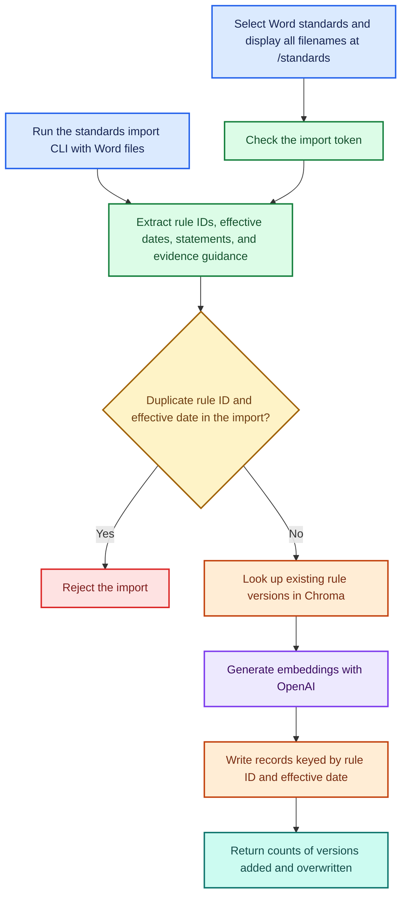
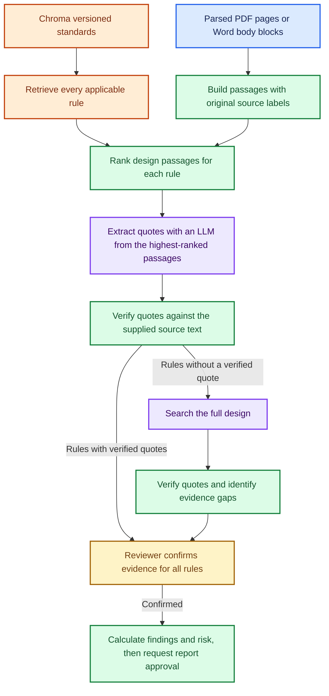

# AI Architecture Governance Assistant

Select the diagram to open the full-resolution image.

The review runs through six LangGraph nodes with two human decisions. Chroma stores versioned standards. Live review state resides in backend memory until a restart. The image shows single-report evaluation. The [Arize AX benchmark workflow](flowdiagrams.md#arize-ax-benchmark) uses the bundled designs, standards, and answer workbook to evaluate extraction and gap assessment in batches.

The [performance reporting workflow](flowdiagrams.md#performance-dashboard) connects the benchmark and application checks to the separate `/performance` page. At startup, FastAPI publishes the full benchmark dataset and templates to Arize AX in the background when configured. Token-authorized actions can run the benchmark, publish assets, run backend tests in a separate Python process, or validate fixtures. FastAPI reads the latest summaries from disk as the page polls for progress.

## Diagram colors

| Color | Meaning |
| --- | --- |
| Blue | People, uploads, and browser interactions |
| Green | API and deterministic processing |
| Purple | OpenAI calls and LLM evidence extraction |
| Orange | Standards storage and saved review state |
| Amber | Validation branches and human decisions |
| Teal | Results and completed steps |
| Red | Rejection |
| Gray | Optional integrations and workflow boundaries |

Node labels and arrow labels also identify each step and decision.

## RAG upload

Approved Word standards enter through the token-protected upload API or the CLI. The import extracts and validates rules, generates OpenAI embeddings, and stores each rule version in Chroma. A matching rule ID and effective date overwrites that version.

Standards maintainers can also clear the configured Chroma standards collection from `/standards`. The browser asks for confirmation and the backend validates the import token before deleting the rule versions and their embeddings. The next import recreates the collection. See the [reset workflow](flowdiagrams.md#rag-database-reset).

## Rule selection and evidence retrieval

### Review flow

`retrieve_applicable_rules` retrieves the latest effective version of every applicable rule from Chroma using the selected document type and standards date. `extract_evidence_with_llm` ranks passages **from the uploaded design** using keyword overlap and OpenAI embeddings, asks the LLM for supporting quotes, and verifies each quote against its cited source.

Passage text and embeddings are used during extraction. Chroma continues to store the approved standards. For short designs and when passage ranking is unavailable, extraction searches the full design directly. Every applicable rule reaches the reviewer with either a verified citation or an evidence gap. See the [workflow diagrams](flowdiagrams.md#document-review) and [baseline comparison procedure](backend/README.md#compare-retrieval-with-the-full-document-baseline).

The review API provides two on-demand actions for rules with evidence gaps. **Suggest next step** uses the approved rule and relevant design passages to draft guidance. **Recheck with a supporting document** searches the uploaded file for that rule alone while evidence confirmation is pending. FastAPI stages a verified candidate in the checkpoint state. `confirm_evidence` includes the candidate only when the reviewer selects its quote and confirms the evidence. The policy node then calculates gaps and risk using the confirmed evidence.
