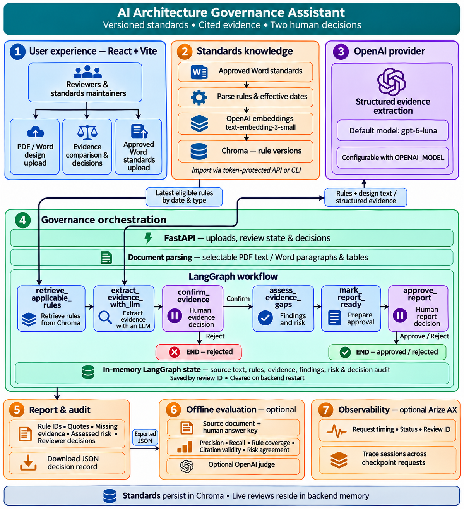
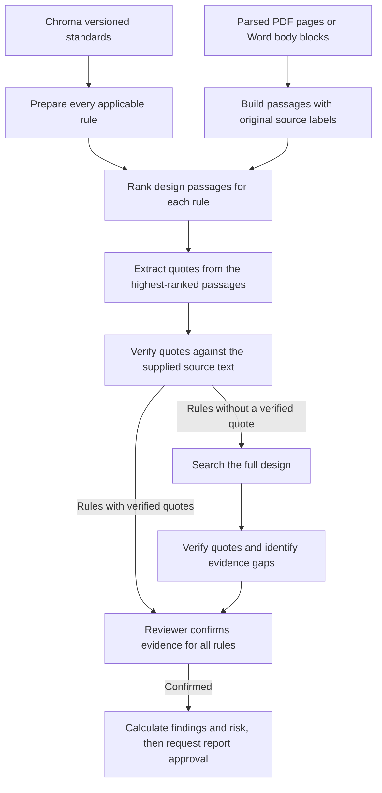

# AI Architecture Governance Assistant

Select the diagram to open the full-resolution image.

The review runs through six LangGraph nodes with two human decisions. Chroma stores versioned standards. Live review state resides in backend memory until a restart. Evaluation runs separately against an exported report and a human answer key.

## Rule selection and evidence retrieval

`prepare` loads the latest effective version of every applicable rule. Applicability comes from the selected document type and standards date. `extract` ranks passages **from the uploaded design** for each of those rules using keyword overlap and OpenAI embeddings.

Passage text and embeddings are used during extraction. Chroma continues to store the approved standards. For short designs and when passage ranking is unavailable, extraction searches the full design directly. Every applicable rule reaches the reviewer with either a verified citation or an evidence gap. See the [workflow diagrams](flowdiagrams.md#document-review) and [baseline comparison procedure](backend/README.md#compare-retrieval-with-the-full-document-baseline).
