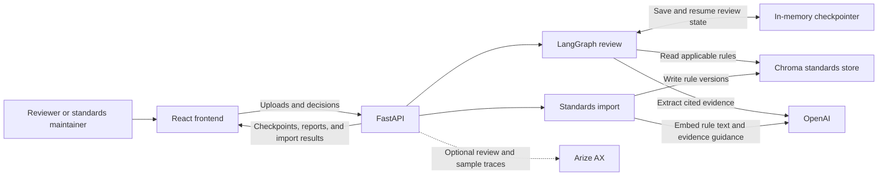
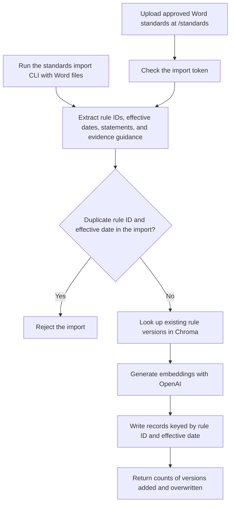
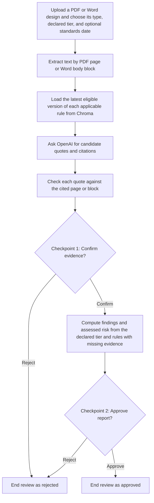
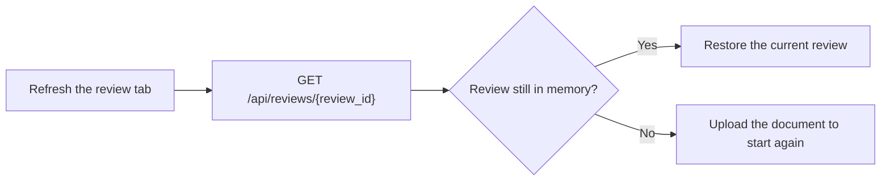
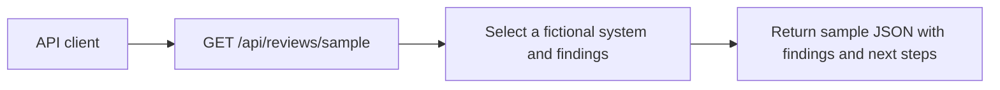
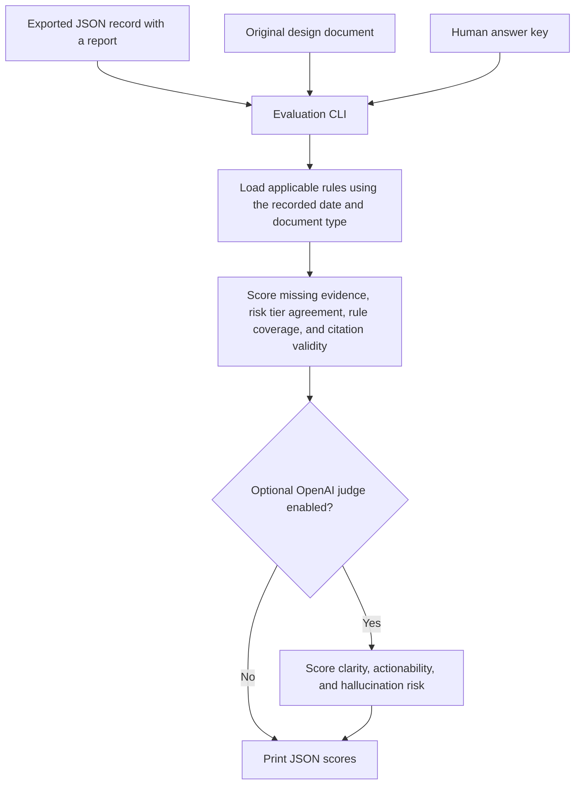
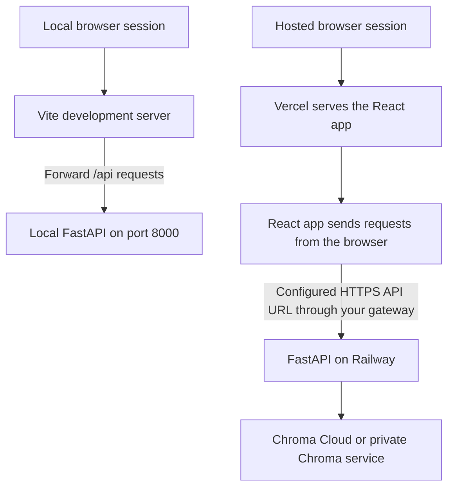

# Architecture Governance Assistant

Architecture Governance Assistant reviews design documents against versioned governance standards. OpenAI extracts cited evidence, LangGraph pauses for two human decisions, and a deterministic policy check produces findings and a risk tier.

## Project components

- The React and Vite frontend uploads documents and presents the evidence and report checkpoints. [Frontend setup, configuration, and build guide](frontend/README.md)
- The Python and FastAPI backend runs the LangGraph workflow, retrieves approved rules from Chroma, and holds review checkpoints in memory until the backend restarts. [Backend setup, API, and Railway deployment guide](backend/README.md)

## Try it locally

Start the backend on port 8000, then start the frontend in a separate terminal using the guides above. Open the URL printed by Vite. To run a document review, configure the backend's `OPENAI_API_KEY` and Chroma connection, then import the [Word standards](backend/standards/README.md). The [sample review API](#sample-review) returns fictional findings without those services.

For the full list of project commands, see the [command reference](COMMANDS.md).

## System architecture

## Standards import

The [standards upload page and CLI](backend/README.md#configure-document-reviews) use the same import logic.

## Document review

The [review page](frontend/README.md) shows each checkpoint as the [review API](backend/README.md#document-review-api) returns it. The backend records the reviewer and decision at both checkpoints. You can download the JSON decision record at any checkpoint.

On refresh, the browser uses the saved review ID to fetch the current state. A backend restart clears that state.

## Sample review

## Report evaluation

The [evaluation CLI](backend/README.md#evaluate-an-exported-report) scores a report after it has been generated.

## Local and hosted request flow

See the [frontend hosting guide](frontend/README.md#connect-to-a-hosted-backend) and the [Railway setup guide](backend/README.md#deploy-on-railway) for configuration.
