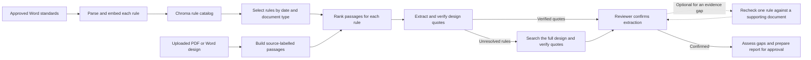

# RAG upload and retrieval

The Architecture Governance Assistant uses retrieval-augmented generation (RAG) to ground a design review in approved standards and quotes from the uploaded design. **Standards upload** builds the rule catalog in Chroma. **Document review** selects the applicable rule versions, looks for supporting passages in the design, and verifies each quote returned by the model.



## 1. Upload and index approved standards

1. **Submit Word documents.** A standards maintainer selects approved `.docx` files on `/standards` and enters the import token. The browser sends the files to `POST /api/standards/import` with that token as a bearer credential. The CLI uses the same rule parser and Chroma importer. The upload API accepts up to 10 files, 10 MB per file, 20 MB combined, and 200 rules in one import. [Import API](../backend/governance/api/standards_import.py), [setup and CLI](../backend/README.md#configure-document-reviews)
2. **Read the rule blocks.** The parser reads `Document ID` and `Effective date` from the metadata table before `3. Rules`. Between `3. Rules` and `4. Exceptions`, each rule takes three consecutive paragraphs. The first contains the rule ID and title, the second contains the requirement, and the third starts with `Evidence expected in the design document:`. The importer assigns these rules to solution design and architecture decision reviews, with a medium-risk default for missing evidence. [Word template](../backend/standards/README.md), [rule parser](../backend/governance/standards_store/source_documents.py)
3. **Validate versions and generate embeddings.** The importer builds an ID such as `DEMO-01:2026-01-01` from the rule ID and effective date. A duplicate ID within one batch fails validation. For each rule, OpenAI `text-embedding-3-small` turns the requirement and evidence guidance into one numeric vector. [Importer](../backend/governance/standards_store/ingestion.py), [embedding provider](../backend/governance/providers/openai.py)
4. **Save each version to Chroma.** A record contains the version ID, the rule as JSON, its embedding, and metadata for the rule ID, standard ID, and effective date. Chroma stores the date metadata as an integer to support date filtering. The collection defaults to `governance-standards`. Reimporting the same rule ID and date overwrites that version. Importing the same rule ID with a later date creates a new record. The API returns counts of versions added and updated. [Importer](../backend/governance/standards_store/ingestion.py), [catalog](../backend/governance/standards_store/catalog.py)

## 2. Retrieve rules and find evidence in a design

1. **Parse the design.** On `/review`, the reviewer submits a text-based PDF or Word document, document type, declared risk tier, and optional standards date. The API uses the server date when the standards date is omitted. Extracted text keeps source labels such as `Page 3`, `Paragraph 8`, or `Table 12`. [Review API](../backend/governance/api/document_reviews.py), [document parser](../backend/governance/agent/documents.py)
2. **Select applicable rule versions.** The `retrieve_applicable_rules` LangGraph node asks Chroma for rule records effective on or before the chosen date. The backend keeps the newest eligible version per rule ID, then filters those versions by document type. This lookup uses Chroma date metadata and stored rule JSON. Every applicable rule proceeds to evidence extraction. [Catalog](../backend/governance/standards_store/catalog.py), [workflow graph](../backend/governance/agent/graph.py)
3. **Build and rank design passages.** The backend groups adjacent short sections and splits longer ones into 2,000-character windows with 300 characters of overlap. Each passage retains its source labels. For a design with more than three passages, it embeds each passage and a query made from each rule's requirement and evidence guidance in a single OpenAI request. These review-time vectors are used in memory. The ranker weights shared keywords by how rare they are across the passages and calculates semantic similarity using cosine similarity. It ranks the two scores separately and adds `1 / (60 + rank)` for each positive match. It keeps up to three passages per rule. Chroma's stored rule vectors are created during import, while this ranker uses fresh vectors for the queries and design passages. [Passage ranker](../backend/governance/agent/retrieval.py)
4. **Extract and verify quotes.** The model receives each rule, the allowed passage IDs for that rule, and the selected passage text. It returns structured candidates with `rule_id`, `source`, and `quote`. The backend normalizes whitespace and checks that each candidate is a substring of its cited source in the passages supplied for that rule. It retains the first verified quote per rule. A source match confirms the text was present. The reviewer decides whether it supports the requirement. [Evidence extractor](../backend/governance/agent/evidence.py), [extraction prompts](../backend/governance/agent/prompts.py)
5. **Retry unresolved rules against the full design.** The model receives the full parsed design for rules still missing a verified quote, including rules with no ranked passage. The same source check applies. The backend goes directly to the full design when there are at most three passages, ranking fails with an OpenAI or value error, or `EVIDENCE_RETRIEVAL_MODE` is set to `full_document`. Approved rules and their vectors stay in Chroma. The parsed design and review state reside in backend memory. [Evidence extractor](../backend/governance/agent/evidence.py), [review state and persistence](../backend/README.md#document-review-api)
6. **Confirm evidence and assess risk.** LangGraph pauses for the reviewer to verify the extraction. After confirmation, each rule becomes an evidenced finding or an evidence gap. The assessed risk tier is the highest of the declared tier and any applicable gap risks. A second human decision approves or rejects the report. [Risk assessment](../backend/governance/agent/policy.py), [workflow graph](../backend/governance/agent/graph.py)

## Worked example

This example uses fictional rules and design text to show version selection, quote verification, and risk assessment.

### Import two rules

Create a Word standard whose metadata table contains these two rows. The text in the right column goes in the cell to the right of its label.

| Metadata field | Value |
| --- | --- |
| Document ID | `STD-99` |
| Effective date | `2026-01-01` |

Use these paragraphs in the rules section. Each line represents a separate Word paragraph.

```text
3. Rules
DEMO-01 Storage encryption
Customer records must be encrypted at rest.
Evidence expected in the design document: Name the datastore and state how it is encrypted at rest.
DEMO-02 Restore testing
The design must specify a quarterly restore test.
Evidence expected in the design document: State the restore-test frequency and identify the owner.
4. Exceptions
```

On an empty catalog, importing that document returns `{"added": 2, "updated": 0}`. The records are `DEMO-01:2026-01-01` and `DEMO-02:2026-01-01`. Now import a second Word document for `STD-99` with an effective date of `2026-07-01` and only `DEMO-01`, whose updated requirement also asks for a named key manager. The result is `{"added": 1, "updated": 0}`. Both versions of `DEMO-01` remain available for date-based selection.

### Review a solution design

Upload a solution design with a **low** declared tier and set the standards date to **15 August 2026**. The catalog selects the July version of `DEMO-01` and the January version of `DEMO-02`. A review as of **15 June 2026** would select the January version of `DEMO-01` instead.

Suppose the PDF contains enough text to produce more than three passages. Two of its source sections contain the following text.

| Source | Extracted design text |
| --- | --- |
| Page 3 | The customer records database is encrypted at rest with a key managed by AWS KMS. |
| Page 5 | The database takes a backup every night. |

1. **Encryption has supporting evidence.** Page 3 is likely to rank highly for `DEMO-01`. If the model returns the exact sentence with `source: "Page 3"`, the backend finds it in the supplied source and retains it. The reviewer can check that it names the datastore and key manager and states that encryption applies at rest.
2. **Restore testing has an evidence gap.** Page 5 may rank for `DEMO-02` because backup and restore are related. The sentence gives a backup schedule. The rule asks for the frequency and owner of restore tests. Suppose the model returns no supporting quote in the passage pass or the full-design pass. The extraction then shows `DEMO-02` as **Not evidenced**.
3. **The gap raises the assessed tier.** After the reviewer confirms the extraction, `DEMO-01` is evidenced and `DEMO-02` has a medium-risk evidence gap. The report assesses **medium** risk from the low declared tier and the medium gap risk. Another reviewer decision finalizes the report.

The evidence check also catches citation mistakes in this example. If the model attributes the Page 3 sentence to Page 5, the backend discards that candidate because the quoted text does not occur on the cited page. If `DEMO-01` has no other verified quote, it goes through the full-design pass.

Before confirming the evidence, the reviewer could select **Suggest next step** on `DEMO-02`. A suggestion could ask for the continuity plan that identifies the restore-test owner and schedule. The reviewer can upload that plan to recheck `DEMO-02`, read any verified quote, and select it for inclusion at confirmation. An included quote closes that evidence gap and cites the supporting plan in the report. [Evidence-gap actions](../frontend/README.md#work-on-an-evidence-gap)
