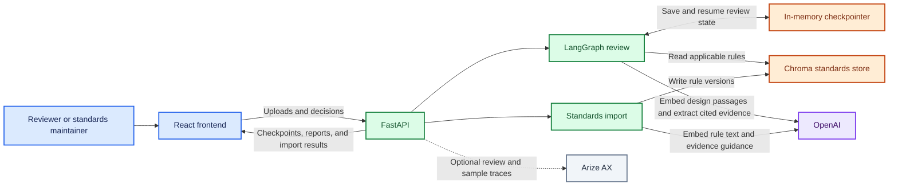
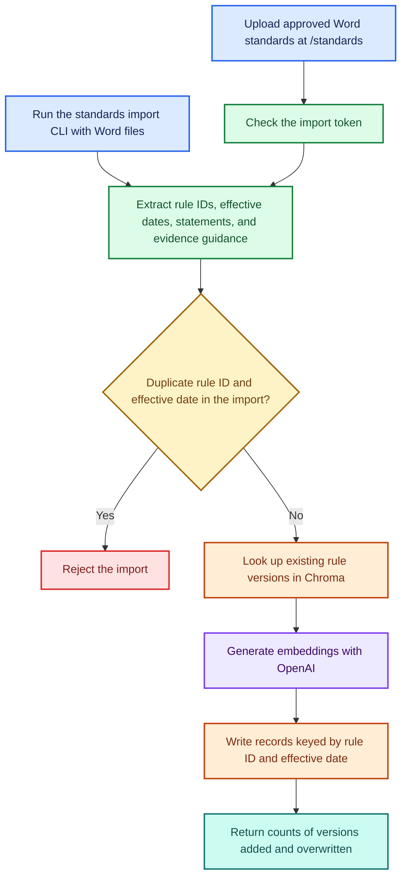
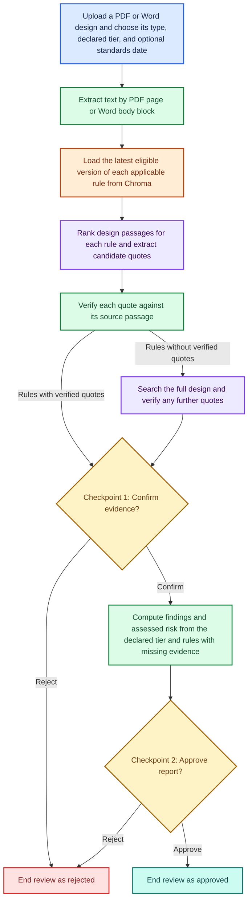
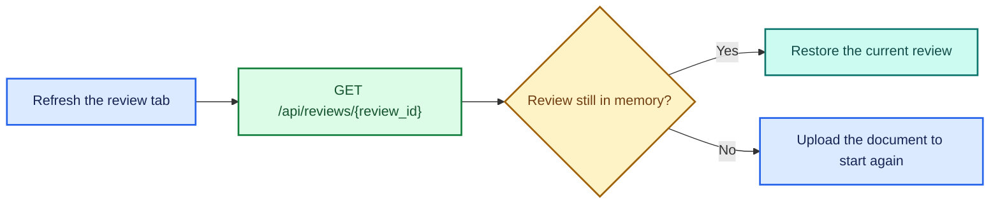
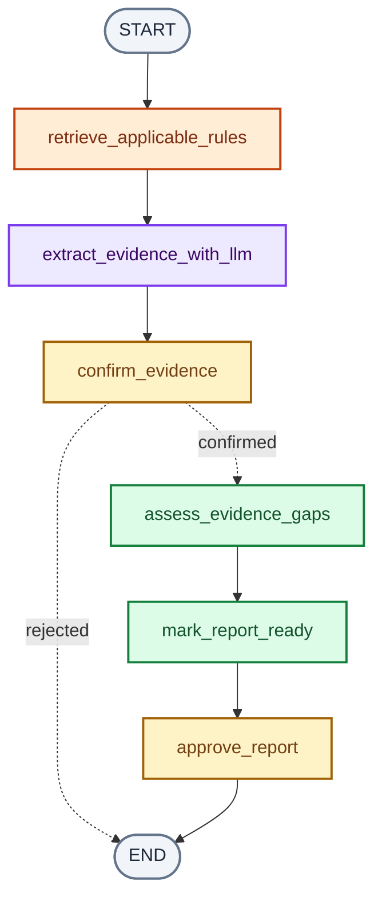
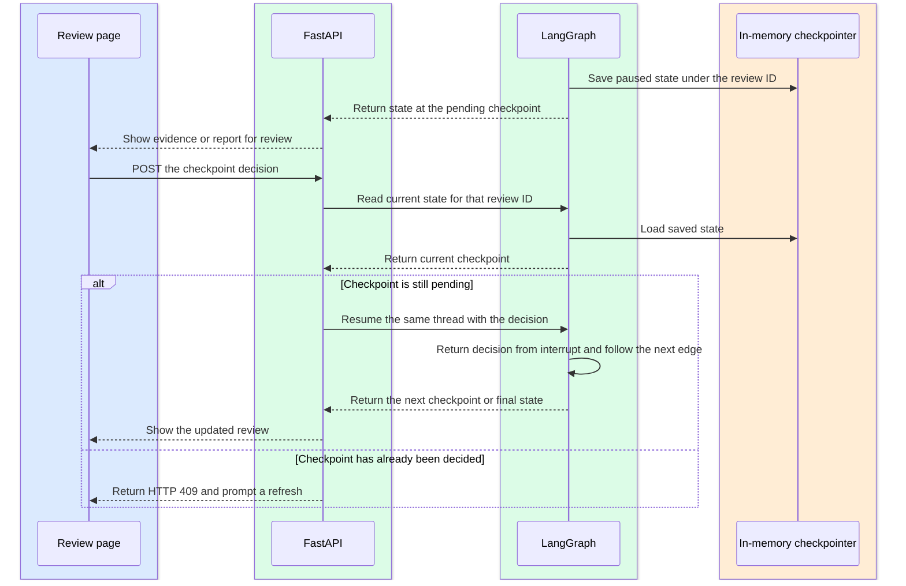
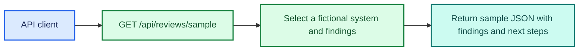
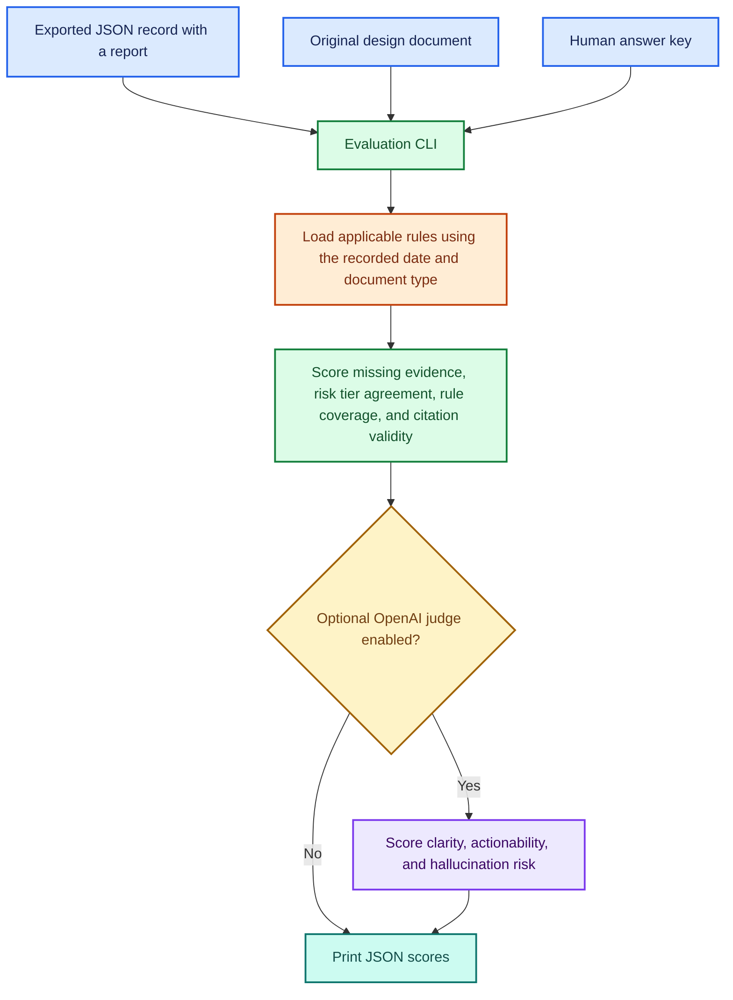
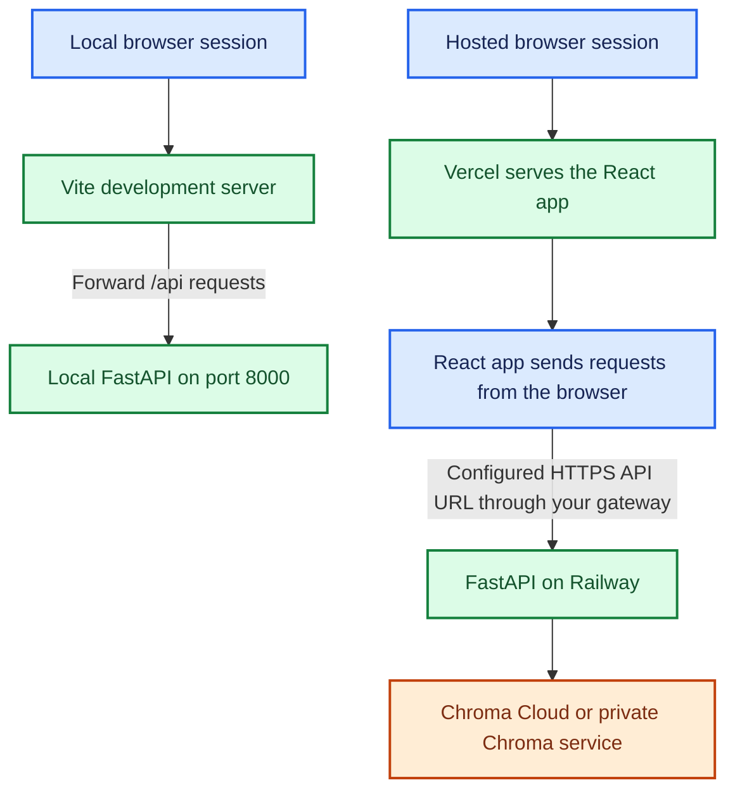

# Architecture and workflows

## Diagram colors

| Color | Meaning |
| --- | --- |
| Blue | People, uploads, and browser interactions |
| Green | API and deterministic processing |
| Purple | OpenAI calls and LLM evidence extraction |
| Orange | Standards storage and saved review state |
| Amber | Validation branches and human decisions |
| Teal | Results and completed steps |
| Red | Rejection |
| Gray | Optional integrations and workflow boundaries |

Node labels and arrow labels also identify each step and decision.

## System architecture

## Standards import

### RAG upload flow

Upload approved standards to build the knowledge store before starting a design review. This flow ends when rule versions and their embeddings are saved in Chroma.

The [standards upload page and CLI](backend/README.md#configure-document-reviews) use the same import logic.

## Document review

### Review flow

This flow starts with a solution design and reads the standards already imported into Chroma. Design passage ranking and evidence extraction run during this review.

The [review page](frontend/README.md) shows each checkpoint as the [review API](backend/README.md#document-review-api) returns it. The backend records the reviewer and decision at both checkpoints. You can download the JSON decision record at any checkpoint.

The [retrieval architecture](ARCHITECTURE.md#rule-selection-and-evidence-retrieval) shows how every applicable rule stays in scope. On refresh, the browser uses the saved review ID to fetch the current state. A backend restart clears that state.

## LangGraph nodes and edges

The [graph definition](backend/governance/agent/graph.py) registers six Python functions as nodes. Each node reads the shared [review state](backend/governance/agent/state.py) and returns the fields it updates. FastAPI parses the uploaded document before invoking the graph and supplies the text sections, document type, declared risk tier, and standards date as the initial state.

| Node | What it does |
| --- | --- |
| `retrieve_applicable_rules` | Retrieves the latest effective version of every applicable rule from Chroma. |
| `extract_evidence_with_llm` | Ranks design passages per rule, extracts quotes with an LLM, and verifies them against the source text. It searches the full design for unresolved rules before setting the stage to `confirm_evidence`. |
| `confirm_evidence` | Pauses for the evidence decision, appends it to the audit history, and sets the stage to `confirmed` or `rejected`. |
| `assess_evidence_gaps` | Applies policy rules to produce findings and calculate the assessed risk tier. |
| `mark_report_ready` | Sets the stage to `approve_report` so the generated findings are ready for the next reviewer decision. |
| `approve_report` | Pauses for the report decision, appends it to the audit history, and sets the final stage to `approved` or `rejected`. |

Solid arrows are fixed edges registered with `add_edge`. The dashed arrows are the two outcomes of the conditional edge registered with `add_conditional_edges`. After `confirm_evidence` resumes, `after_confirmation` reads the stage and sends the review to `assess_evidence_gaps` or directly to `END`. Both report decisions follow the same fixed edge from `approve_report` to `END`. `START` and `END` mark the graph boundaries.

### How a decision resumes the graph

Both `confirm_evidence` and `approve_report` call `interrupt()`. LangGraph saves the paused state in the in-memory checkpointer under the review ID, which the API passes as the LangGraph thread ID. The decision endpoint checks that the submitted checkpoint is still pending, then resumes the same thread with `Command(resume=...)`. LangGraph re-enters the paused node and `interrupt()` returns the submitted decision.

## Sample review

## Report evaluation

The [evaluation CLI](backend/README.md#evaluate-an-exported-report) scores a report after it has been generated.

## Local and hosted request flow

See the [frontend hosting guide](frontend/README.md#connect-to-a-hosted-backend) and the [Railway setup guide](backend/README.md#deploy-on-railway) for configuration.
